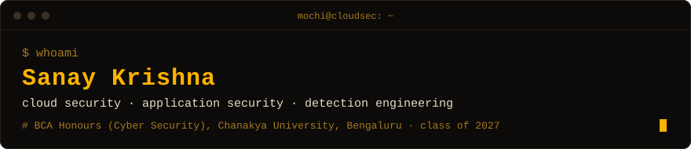
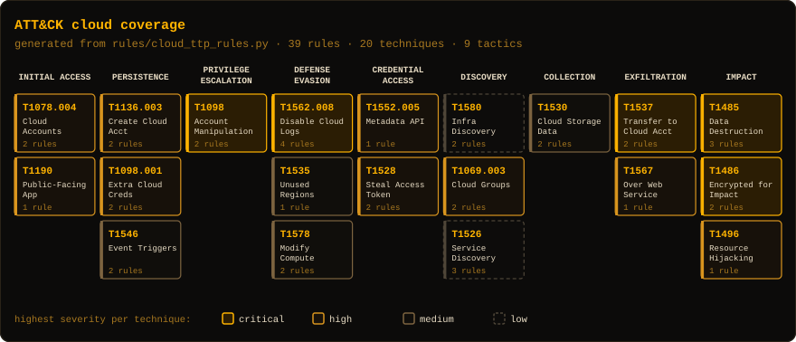

  

  <a href="https://www.linkedin.com/in/sanaykrishna">LinkedIn</a> ·
  <a href="https://sanay.foo">sanay.foo</a> ·
  <a href="https://tryhackme.com/p/mochi1">TryHackMe</a> ·
  <a href="mailto:sanay.rein@gmail.com">sanay.rein@gmail.com</a>

---

Final-year BCA Honours (Cyber Security) student at Chanakya University, Bengaluru. I work across application security and cloud security: threat modelling apps before they ship, and writing detection logic for AWS.

**Looking for:** security analyst, application security, or cloud security internships.

---

### Experience

**Application Security Intern · Genki to Asia Co., Ltd. (Japan)** · Dec 2025 to present

Co-designing the security architecture for KoKoMata, a location-based mobile app, with a fellow intern. Users pin a photo and a story to a place. When someone else walks nearby, the app tells them something is hidden there, and they go and see it from the poster's point of view. Because every pin is tied to a real location, the main privacy risk is a pin giving away where someone lives or spends time, so exact coordinates never reach a client.

- Access control in three independent layers: Row Level Security on every table, secrets isolated in a private schema with no client grants, and privileged database functions as the only path to sensitive data
- HMAC-based location jitter keyed by a server-side secret, so pin locations stay coarse but stable
- OAuth-only authentication, server-side JWT checks, and on-device token storage in the OS keychain
- Audit logging and rate limiting on unlock attempts, mapped against OWASP Top 10 and Mobile Top 10

---

### Projects

**[Mitre-Cloudtrail-Detection](https://github.com/SanayKrishna/Mitre-Cloudtrail-Detection)** · detection engineering
Maps AWS CloudTrail events to MITRE ATT&CK cloud techniques. 39 rules across 20 techniques and 9 tactics, written as data so new detections need no engine changes. Alerts are enriched from the official STIX bundle. 33 tests.

View technique coverage

 

  

**[CloudScanner](https://github.com/SanayKrishna/CloudScanner)** · cloud posture
Event-driven S3 security: CloudTrail, EventBridge, Lambda and SNS for real-time alerts on suspicious API activity, plus misconfiguration audits mapped to the CIS AWS Foundations Benchmark. Infrastructure in Terraform.

**[Ai-Powered-Soar-Engine](https://github.com/SanayKrishna/Ai-Powered-Soar-Engine)** · automation
Random forest risk scoring per alert, triggering conditional response playbooks, with an audit trail in SQLite. Slack alerting currently uses a mock webhook.

**Hackathons:** 2nd place, IKS Hackathon 2026 (ChandaEngine) · 3rd place, Srujana Hackathon 2025 (Netā-Nomics)

---

### Stack

**Security:** OWASP Top 10 / Mobile Top 10, threat modelling, MITRE ATT&CK, CIS AWS Benchmark
**Cloud:** AWS (CloudTrail, EventBridge, Lambda, S3, SNS, IAM), Terraform, Boto3
**Code:** Python, FastAPI, pytest, PostgreSQL / Supabase, TypeScript, React

**Currently:** preparing for CompTIA Security+ (SY0-701).
